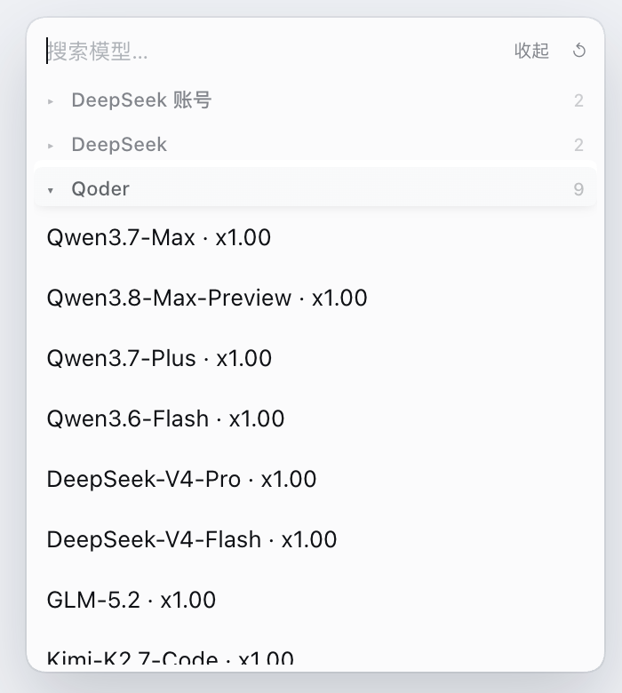
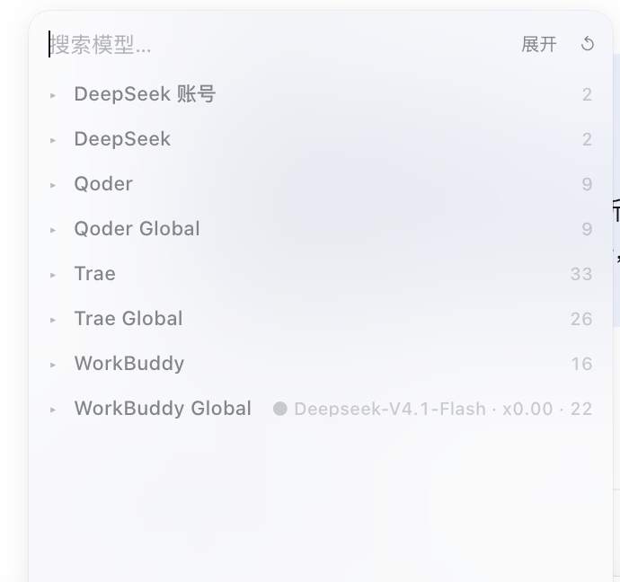
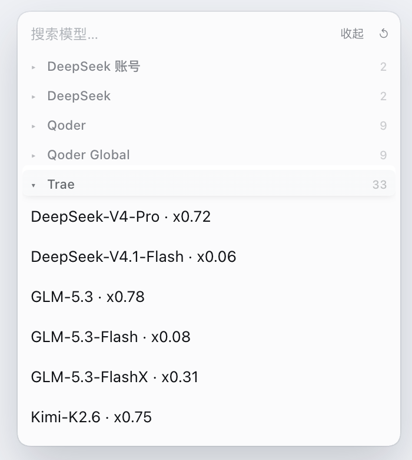
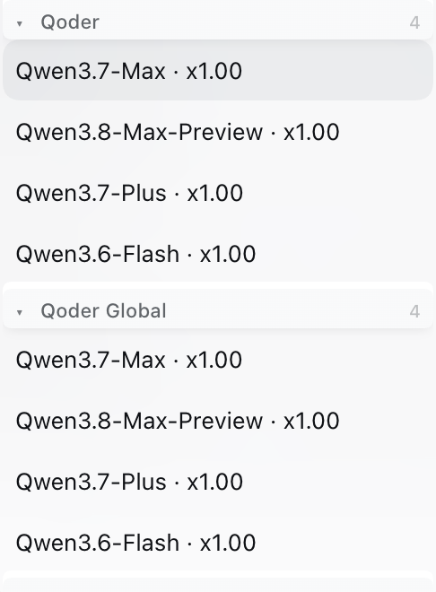
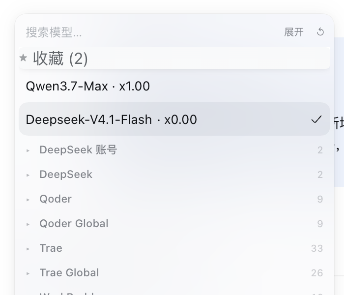
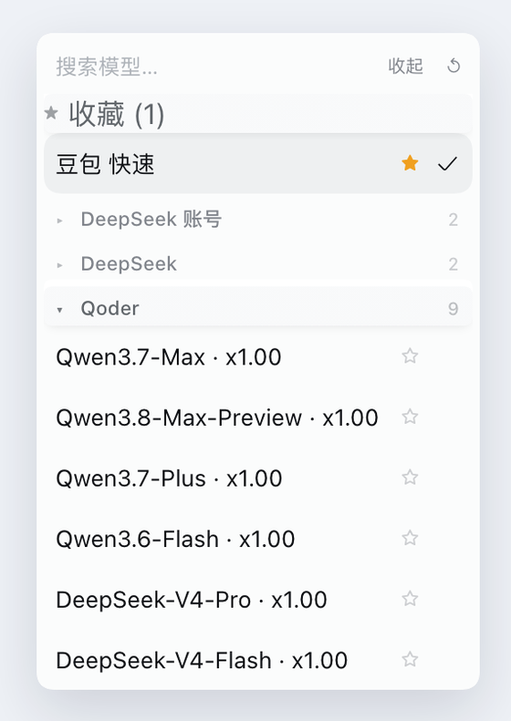
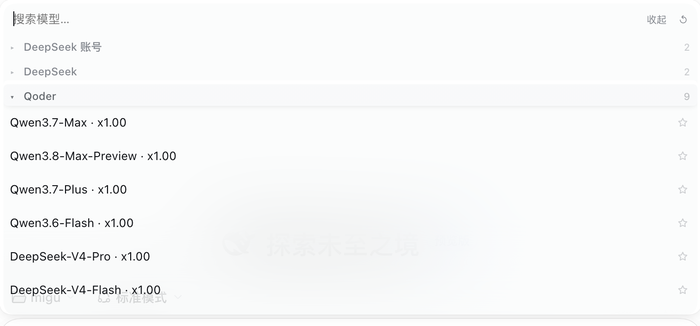

# dsh-model-accordion

**English** · [简体中文](./README.zh.md)

> Collapse the DeepSeek Harness model list into **one clickable label per provider**.
> Click `Qoder` and only Qoder's models appear — every other provider folds away.

<p align="center">
  
</p>

If you have a dozen providers and a few hundred models, the stock picker is one
endless scroll. This plugin turns each provider into a single row: you see the
provider names, the model count, and nothing else until you ask for it.

Works in **both** places the model list appears:

- the model menu next to the composer;
- the `/model` slash-command popup.

---

## What it looks like

| Every provider collapsed | One provider expanded | Search |
| --- | --- | --- |
|  |  |  |
| Nine providers in 8 rows. Click a row to open it. | `Trae` open with 33 models; the rest stay folded. | Typing `qwen` expands every match automatically. |

<p align="center">
  
</p>

Favorites are pinned above the providers, so the two or three models you actually
use are always one click away.

<p align="center">
  
</p>

Every row carries a star on its right edge: click it to bookmark the model without
selecting it, so you can pick out several models in a single visit to the menu. The
same star appears in the `/model` popup, where the rows are wider:

<p align="center">
  
</p>

---

## Features

| Feature | How |
| --- | --- |
| **Accordion** | Click a provider label: it opens and every other provider closes. |
| **Collapse everything** | Click the open provider again, or the toolbar button. |
| **Multi-open** | `Ctrl`/`Cmd` + click a label to toggle it without closing the others. |
| **Expand / collapse all** | Toolbar button at the right end of the search row. |
| **Remembered state** | Open providers survive closing the menu and reloading the page. |
| **Star button** | Every row has a star on its right edge; click it to favorite the model without selecting it. |
| **Favorites** | `Shift`+click, right-click or the star pins a model to the `★` section; click a pinned row to select it. |
| **Favorites in the first-level menu** | The short pane the composer menu opens on (`模型` / `推理等级`) lists your favorites above those two cells, so a favorite is one click away instead of two. |
| **Stable favorite keys** | A connector's rate chip (` · x0.00`) is stripped before it becomes part of a favorite key, so a promotion starting or ending no longer makes a favorite vanish until you switch accounts. |
| **Duplicate names stay distinct** | When one provider ships two models under the same name (a paid and a free `Deepseek-V4.1-Flash`, say), a favorite remembers the exact model that was starred, so clicking it never selects the twin. |
| **Provider sorting** | Toolbar `↺` cycles default order → name (A→Z) → model count (↓N). |
| **One-click model refresh** | Toolbar `↻` re-pulls every connector's model list in parallel and forces the composer catalog to re-read. |
| **Account info** (0.9.0) | The unified hub shows current account name / id / domain / region / expiry, the full account list with per-account credits, credit totals, credit packages, check-in streak and OpenCode IP-pool state. |
| **Model lists** (0.9.0) | The hub lists every model with context window, credit multiplier and reasoning/image/new/off tags; region selector + search box + refresh button. |
| **Account config** (0.9.0) | Add/remove Qoder PATs, switch WorkBuddy accounts, OAuth login, refresh Trae accounts, probe the OpenCode IP pool — directly from the hub. |
| **Qoder local login** (0.9.1) | Pull the Qoder desktop client's **current** sign-in (no PAT needed), record it, and switch to it from the same account dropdown as PAT accounts. See [Qoder local login](#qoder-local-login). |
| **Trae multi-account** (0.9.1) | List every Trae login already saved on this machine and switch between them from the hub — no re-login required. See [Trae local accounts](#trae-local-accounts). |
| **Test a model** (0.9.0) | Each model row has a 「测试」 button that makes one real upstream call and shows the outcome / latency inline. |
| **Current model on the label** | The provider holding the active model shows `● <model> · <count>`. |
| **Stable height** | The menu keeps a constant height instead of jumping between 260 px and 368 px. |
| **Search passthrough** | Typing in the search box expands every provider, so a match can never hide inside a collapsed group. |
| **Keyboard** | `Tab` to a label, `Enter`/`Space` toggles, `↑`/`↓` move between labels, `→`/`←` open/close. |
| **i18n** | Chinese and English strings, picked from the page language. |
| **Hot reload** | Editing `lib/client.js` swaps the bundle in the running page in a second or two. |

The plugin only **decorates the DOM** — it never re-implements the picker. Model
selection, reasoning-effort switching, provider loading and the `/model` command
all stay with `@deepseek-ai/dsh-client-ui-model-selection`, so host updates that
touch selection logic keep working.

---

## Self-contained connectors + unified settings hub

**Since 0.8.0 this is a real physical merge.** The full code of all four
connectors — WorkBuddy (5.17.0), Trae (4.6.12), Qoder
(`@dmh2002/dsh-connect-qoder` 1.16.4) and OpenCode
(`@opencode2dsh/dsh-plugin` 0.3.14) — is vendored inside this package under
`vendored/`. With the standalone bundles stopped and these four hosts served by
`dsh-model-accordion`, **models, sign-in, saved config and settings keep working
even after you uninstall the four original connector plugins in the GUI** — the
"copy the code into this plugin so it still works with the others uninstalled" goal.

How it is wired:

- The profile `cordis.patch.yml` gains four `- insert:` rows whose `name` is a
  `file:` URL pointing at each `vendored/<name>/lib/index.js`. The four `entry.id`s
  are unchanged (`dsh-connect-workbuddy`, `dsh-connect-trae`,
  `dsh-connect-qoder`, `opencode2dsh`) because they are the settings namespace,
  the `/plugins/<id>/...` route prefix and the key for saved config — so the
  hardcoded routes, client fetches, refresh targets, vault/auth filenames and
  version constants need **zero** string changes. The four host `lib/index.js`
  files stay **separate module URLs** (their top-level `Config` schemas and
  module-level `Map`/`let` singletons cannot be merged without cross-talk).
- Each vendored subpackage keeps its own `dsh.client` + `exports["./client"]`;
  `nearestPackage` resolves each `file:` URL to that subpackage's `package.json`
  name, which equals its `lib/client.js` `window.__ModuleLoader__.load({id})` id.
  So the four native settings/login UIs keep working with no client
  concatenation and no slot-key rewrites. The two standalone bundles
  (`dsh-connect-workbuddy`, `@opencode2dsh/dsh-plugin`) are removed from
  `dsh.profile.bundles` so the client graph does not see one package name from
  two sources; their `dependencies` stay so the GUI still lists them as
  uninstallable.
- The `name:` lines on the workbuddy/trae config-override rows and the trailing
  `disabled: true` rows are removed by `install.sh`, so accounts / regions /
  `lastCatalog` / `enabledModelIds` keep applying to the new vendored entries by id.
- The hosts' bare imports (schemastery, pi-ai, dsh-llm, undici, …) resolve from
  the workspace realpath through a small `node_modules/` shim that `install.sh`
  builds: schemastery 3.18.4 + cosmokit come from the copy vendored with
  workbuddy (opencode's `Config` needs `.volatile()`; the global tree only has
  3.18.2 without it), and the other seven deps come from DSH's own
  `~/.dsh/profiles/node_modules` (global-backed, survives `pnpm remove`).
  Verified: DSH's `ResolutionRouter` routes these `file:` URLs to native ESM,
  so the shim is what resolves their bare imports.

The unified settings hub (added in 0.7.0) is the central control panel: a
settings card under "内置插件配置" (Built-in plugin config) on the Plugins page,
putting all four connectors behind one set of tabs. **Since 0.9.0 it also does
what the four native settings pages did** — you no longer need the original
plugins' own config pages:

| Tab | Contents |
| --- | --- |
| **Overview** | Probes every connector at once and shows a status grid (reachability, sign-in state, model count). |
| **WorkBuddy / Trae / Qoder / OpenCode** | Status card + **account info** (current account, account list with credits, credit totals / packages, check-in, credential expiry), **model list** (every model with context window / credit multiplier / tags, region selector, search, refresh) and **account config** (Qoder PAT add/remove, **local desktop login pull/record/switch**, Qoder account dropdown switch, WorkBuddy account switch + OAuth login, Trae account refresh, OpenCode IP-pool probe). Each model has a **test** button. |
| **Accordion options** | Sort mode, stable height, favorites (clear), the auto-probe toggle and a refresh-all button. |

The hub re-implements the connector config flows with plain browser `fetch`
against the vendored hosts' existing same-origin routes. The reference
`daddy-suite` code contributed its data-normalization / card / polling patterns
(60 s refresh, skipped while `document.hidden`); its CDP / `window.ipc` /
Electron-specific parts are not portable to a DSH web-client plugin and were
deliberately not copied. "Open connector settings" also still tries to jump to
that package's detail view under "已安装插件"; **once the original standalone
plugins are uninstalled that list row is gone**, so the button shows a clear
message instead — but the hub itself always stays available and all four hosts
are provided by this package regardless of what the Plugins page lists.

Status probes are read-only: `GET <prefix>/usage?region=<r>` **without**
`detail=fast` (0.9.0 keeps the full account / credits / models payload),
`GET <prefix>/account-credits?region=<r>` for per-account credits, and
`POST /api/opencode2dsh/ip-pool/status` + `/models` for OpenCode. Any
`400`/`404`/`405` or timeout shows "Unknown" rather than an error, so an
unreachable endpoint never breaks the card. Write routes are loopback-guarded:

| Connector | Account config | Test a model |
| --- | --- | --- |
| WorkBuddy | `POST /__save {field:"accounts"}` (switch), `/oauth?action=start\|poll` (login), `/accounts/refresh` | `POST /probe {modelIds:[id]}` |
| Trae | `POST /local-accounts?region=<r> {action:sync\|switch, accountId}` (switch), `/accounts/refresh`, `POST /__save` equivalent via settings (add account goes through the desktop app / `/transfer`) | `POST /models/test {ids:[id]}` — **costs real quota** |
| Qoder | `POST /__save {field:"regions", value:{[r]:{accountId}}}` (switch), `POST /accounts?action=add\|remove {pat/accountId}`, `GET\|POST /local-login?region=<r> {action:pull\|select\|remove}` (desktop sign-in) | `GET /probe?model=<id>` |
| OpenCode | `/ip-pool/probe {scope:"all"}` | — (no per-model probe) |

### Qoder local login

Qoder's desktop client keeps its sign-in in an Electron `safeStorage` blob at
`~/Library/Application Support/com.qoder(cn).app.stable/auth.v1.dat`. The hub's
Qoder tab can read it directly, so you do **not** need to create a Personal
Access Token to use the account you are already logged into:

1. Sign in to the account you want in the Qoder desktop client.
2. Open the hub → **Qoder** → 「Qoder 本地登录」 → 「拉取当前本地登录」.
3. The account is recorded under `~/.dsh/.qoder-local-logins.<region>.json`
   (`0600`) and appears in the 「切换账号」 dropdown alongside PAT accounts.
4. Select it (or the row's 「切换账号」 button). That writes
   `regions.<region>.accountId`, the connector's normal selection field.

Switching between recorded accounts requires switching the sign-in in the Qoder
client first and pulling again — the client has exactly one live session, so a
recorded account that is not the current sign-in is **rejected with a clear
error** rather than silently serving a different account.

Under the hood this is not a PAT: the desktop `dt-` device token cannot be used
for the gateway's `jobToken` exchange (it returns `401 personal token is
invalid`), but it is accepted directly as the COSY `security_oauth_token` when
the session carries the real uid from the decrypted login. The connector host
therefore has a device-credential branch that builds the COSY session from the
live desktop sign-in and drives chat / models / usage through it. Credentials
are re-read from the encrypted client file on every use — the ledger and the
web API contain only identity metadata (uid, name, expiry), never tokens.

### Trae local accounts

The Trae connector already supports multiple accounts in its own credential
file (`~/.dsh/.trae-auth.<region>.json`, a `{version:2, credentials:[...]}`
array). By default the host only mirrors the desktop client's **current** login
into that file, so the hub shows a single account. But every Trae login you have
ever used on this machine is already saved with a usable token in TraeDaddy's
account library:

```
~/Library/Application Support/TraeDaddy/profiles/
  trae-solo-cn/trae-native-<uid>.json     # CN accounts
  trae-solo-intl/trae-native-<uid>.json   # international accounts
```

The hub's Trae tab reads that library directly:

1. Open the hub → **Trae** → 「Trae 本地账号库」. Every saved login is listed
   with its nickname and an 「客户端当前登录」 tag.
2. Click 「同步本地账号」 once to merge all of them into the connector's
   credential file (this also happens automatically on any switch).
3. Pick an account from the 「切换账号」 dropdown, or use the row's 「切换」
   button. The change takes effect immediately — verified with a real upstream
   model call — and survives a restart.

Switching merges the library into the connector's own file, calls
`store.selectAccount(id)` for the current session, and writes
`accounts.<panel>` through the same settings path the native settings page
uses. The chosen account is also placed first in the credential file as an
independent fallback, so the selection persists even if the settings service
is unavailable. The web API returns only identity metadata (uid, nickname,
expiry, active flag); **tokens never leave the host process**.

The card is listed under "内置插件配置" because of the hub client's `plugins.item`
slot registration; the plugin manager builds that list purely from slot entries,
so it is independent of the installed-package list and no host `Config` is
needed. The main host half (`lib/index.js`) stays a dependency-free no-op; the
real model / sign-in / config capability comes from the four independent
`vendored/<name>/lib/index.js` entries. The hub's own UI preferences live in
`localStorage`, not in connector config.

---

## Install

The desktop profile is owned by the Electron app, so `dsh plugin add` refuses to
touch it. Install manually — or use the script:

```sh
git clone https://github.com/lllbjs/dsh-model-accordion.git
cd dsh-model-accordion
./install.sh desktop        # or: ./install.sh "$DSH_PROFILE"
```

The script (idempotent — safe to run again):

1. symlinks this package into `$DSH_HOME/profiles/<profile>/node_modules/dsh-model-accordion`;
2. builds the workspace `node_modules/` shim so the vendored hosts' bare imports
   resolve from the workspace realpath;
3. writes 5 `- insert:` rows (this plugin + the four `file:` connector hosts) to
   the top of `cordis.patch.yml`, backs the file up, and removes 0.7.0 leftovers
   (`name:` overrides and `disabled: true` rows);
4. removes the two standalone connector bundles from `dsh.profile.bundles`
   (keeping their `dependencies` so the GUI can still uninstall them), backing
   the manifest up.

**You MUST fully quit and reopen DeepSeek Harness afterwards** — the profile's
`package.json` / linked roots are read at startup, so a web GUI reload is not
enough (`ResolutionRouter.replace` rejects live replacement). After the restart
you can uninstall the four original connector plugins from the GUI; models,
sign-in and the "模型连接器中心" card should all keep working.

Manual installation is equivalent to running the script; see
[`install.sh`](./install.sh). Writing `cordis.patch.yml` by hand is not
recommended — 0.8.0 needs the four `file:` URL entries, the shim, and the
companion bundles / config / disabled edits together.

### Uninstall

```sh
# 1. delete the - insert: block carrying the
#    "# >>> dsh-model-accordion self-contained connectors" comment (and the old
#    "- id: dsh-model-accordion" insert row)
rm ~/.dsh/profiles/desktop/node_modules/dsh-model-accordion
# 2. to restore the standalone plugins: add the two bundle names back to
#    dsh.profile.bundles and restore the config-override rows from the backup
```

Removing this plugin also removes the four connector hosts (they live in
`vendored/`). Restore from the backups first if you still want the standalone
plugins.

---

## Usage

| Action | Gesture |
| --- | --- |
| Open a provider | Click its label |
| Close the open provider | Click the label again |
| Open a second provider | `Ctrl`/`Cmd` + click |
| Collapse all | Toolbar button, or click the only open provider |
| Favorite a model | Click the star on the row, or `Shift`+click / right-click the row |
| Pick a favorite from the menu's first pane | Click it: the menu drills into the provider list and selects it |
| Select a model | Click it (favorites included) |
| Change sort order | Toolbar `↺` |
| Refresh every connector's models | Toolbar `↻` (spinner → `✓` / `!`) |

---

## Storage

All state lives in `localStorage` on the GUI origin:

| Key | Value |
| --- | --- |
| `dsh-model-accordion:open` | JSON array of open provider labels |
| `dsh-model-accordion:all-collapsed` | `true` when you deliberately closed everything |
| `dsh-model-accordion:favorites` | JSON array of `provider label/model name` keys (the visible text, so the composer menu and the `/model` popup agree) |
| `dsh-model-accordion:sort` | `default` \| `name` \| `size` |
| `dsh-model-accordion:missing-models` | JSON array of favorite keys a complete, unfiltered render proved gone; only these are held back from the first-level pane |
| `dsh-model-accordion:favorite-ids` | JSON object mapping a favorite key to the `data-model-id` that was starred, used to tell apart two models a provider ships under one name |
| `dsh-model-accordion:stable-height` | set to `false` to let the menu size to content |
| `dsh-model-accordion:hub` | unified hub prefs: `{ tab, autoProbe }` (active tab, auto-probe flag) |
| `dsh-model-accordion:last-open` | legacy key, still written for older builds |

---

## Diagnostics

While mounted, `window.__dshModelAccordion` is available in the page console:

```js
__dshModelAccordion.version      // "0.9.0"
__dshModelAccordion.rescan()     // re-run the DOM sweep
__dshModelAccordion.state()      // [{ open: [...], groups: [{ label, models, collapsed }] }]
__dshModelAccordion.favorites()  // ["qoder/qmodel_latest", ...]
__dshModelAccordion.sort()       // "default"
__dshModelAccordion.refresh()    // run the one-click refresh, returns a promise of the summary
__dshModelAccordion.refreshState()          // { status: "idle"|"busy"|"done"|"failed", at, detail }
__dshModelAccordion.refreshTargets()        // ["workbuddy/cn", "workbuddy/global", "trae/cn", "trae/ai", "qoder/cn", "qoder/global"]
__dshModelAccordion.registerRefreshTarget(t) // add a connector target; returns a disposer
__dshModelAccordion.hub.connectors()        // id/pkg/version/providers/regions of the four connectors
__dshModelAccordion.hub.probe(conn)         // probe one connector, returns a status object
__dshModelAccordion.hub.openNative(pkg)     // open that connector's settings detail page
__dshModelAccordion.hub.state()             // current hub prefs (tab / autoProbe)
```

If a model list is on screen but no provider sections are recognised, the console
logs:

```
[dsh-model-accordion] a model list is present but no provider sections were found; the menu markup may have changed
```

That means the host's menu markup changed — update `ROW_SELECTOR` and the
`[data-menu-group]` assumptions in [`lib/client.js`](./lib/client.js).

---

## One-click model refresh

The `↻` toolbar button re-pulls the four bundled connectors' (vendored hosts')
model lists in parallel, then forces the composer's cached model catalog to
re-read. Reopening the menu alone does **not** re-fetch: `ModelCatalogDirectory.load()`
short-circuits while its status is `ready`, so the button calls
`ctx.get("modelDirectories").catalog.refresh()` (invalidate + load) — the one
browser-side path that actually reissues `session/modelCatalog()`.

Built-in targets:

| Connector | Route | Regions |
| --- | --- | --- |
| WorkBuddy | `/plugins/dsh-connect-workbuddy/models/refresh` | `cn`, `global` |
| Trae | `/plugins/dsh-connect-trae/models/refresh` | `cn`, `ai` |
| Qoder | `/plugins/dsh-connect-qoder/models/refresh` | `cn`, `global` |

> Qoder (`@dmh2002/dsh-connect-qoder`) deliberately uses the **unscoped** row id
> `dsh-connect-qoder` and requires `?region=`, so the scoped `@dmh2002/` path is
> wrong (it always 404s).

Each is a same-origin `POST`. An endpoint that is temporarily unreachable answers
`404` or `405` (empty body) and is reported as *skipped*, not as a failure.
Feedback is a spinner while busy, `✓` / `!` afterwards, and a tooltip like
`4/4 · 95 models · catalog`; the state resets after 3.5 s.

### Adding your own connector

Another plugin can register a target without importing this bundle — through a
`CustomEvent` on `document`, or directly:

```js
// event form
document.dispatchEvent(new CustomEvent("dsh-model-accordion:refresh-register", {
  detail: { path: "/plugins/my-connector/models/refresh", label: "mine" }
}));

// direct form (returns a disposer)
const off = window.__dshModelAccordion.registerRefreshTarget(
  "/plugins/my-connector/models/refresh"
);
```

A target may be a URL string, an object
(`{ path, regions?, method?, headers?, label?, regionParam? }`), or an async
function. Two events are broadcast around every run:

- `dsh-model-accordion:refresh-start` — detail `{ targets: string[] }`;
- `dsh-model-accordion:refresh-done` — detail is the summary
  (`{ started, ok, partial, succeeded, skipped, failed, total, models,
  catalogRefresh, results }`).

### Limitation

A connector's `/models/refresh` route only **returns** the live roster into its
settings draft; it does not write `lastCatalog` or emit `llm/adapters-updated`.
Trae's route additionally updates its runtime `latestDiscovery` pool, so its new
models show up immediately. WorkBuddy's host-side catalog changes only after
that connector commits a settings save — a browser plugin cannot force that
republish. The button therefore does the browser-reachable maximum: warm every
connector's upstream data and force the composer to re-read its catalog.

---

## How it works

```
lib/client.js                        browser bundle — accordion + unified settings hub, wrapped in window.__ModuleLoader__
lib/index.js                         main host half — dependency-free no-op (name/inject/apply); hub card comes from the plugins.item slot
vendored/{workbuddy,trae,qoder,opencode}/lib/index.js   four connector hosts (separate module URLs, original entry ids)
vendored/<name>/lib/client.js        four native settings/login clients (each __ModuleLoader__.load id == its subpackage name)
install.sh                           link the package + build the node_modules shim + write 5 insert rows + adjust bundles/config
```

1. A `MutationObserver` on `document.body` (`childList`, `subtree`) sweeps for model
   lists: any element with `id$="-models"` that has `[data-menu-group]` children.
   The same sweep mirrors the favorites into the menu's first-level pane, injecting
   ordinary `button[role="menuitem"]` cells in front of the `模型` cell and copying
   its classes so they look native; they are removed as soon as the pane switches
   to the provider list.
2. Each provider section gets `data-dsh-acc-collapsed`, and the rows of a collapsed
   section are hidden with CSS — no React re-render, no virtual-DOM patching.
3. Click, keydown and input handlers are attached per container (idempotent), and
   the state is written back to `localStorage`.
4. The `/model` popup uses a different markup (`div[role="option"]` rows, no
   `data-provider-id`), so `ROW_SELECTOR` matches both shapes and the popup card is
   laid out as a two-column grid to give the toolbar a home.

---

## Compatibility

- DeepSeek Harness `0.2.1-rc.5` and later (tested against the desktop app bundle).
- No build step: the shipped `lib/client.js` is the browser bundle; the four
  vendored packages are verbatim copies of their published artifacts.
- Runtime deps are resolved by the `install.sh` shim into DSH's own
  `~/.dsh/profiles/node_modules` and workbuddy's bundled schemastery 3.18.4 —
  no `pnpm install` of this repository is needed.

---

## License

MIT
