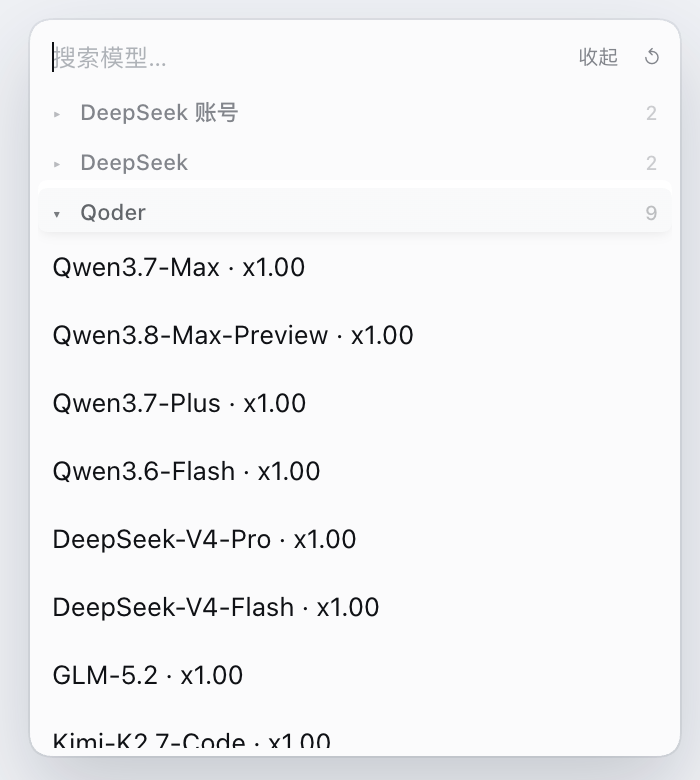
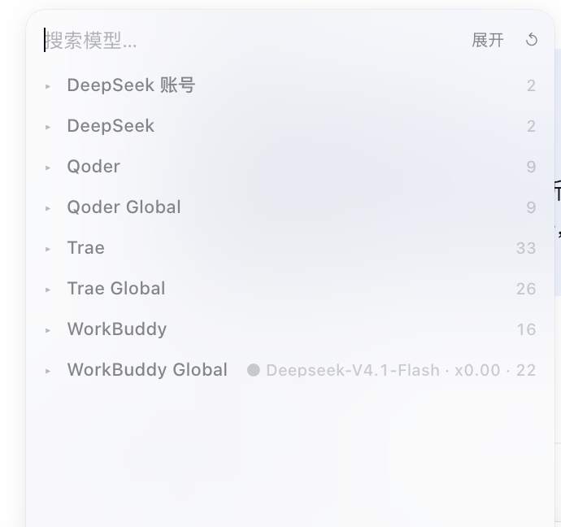
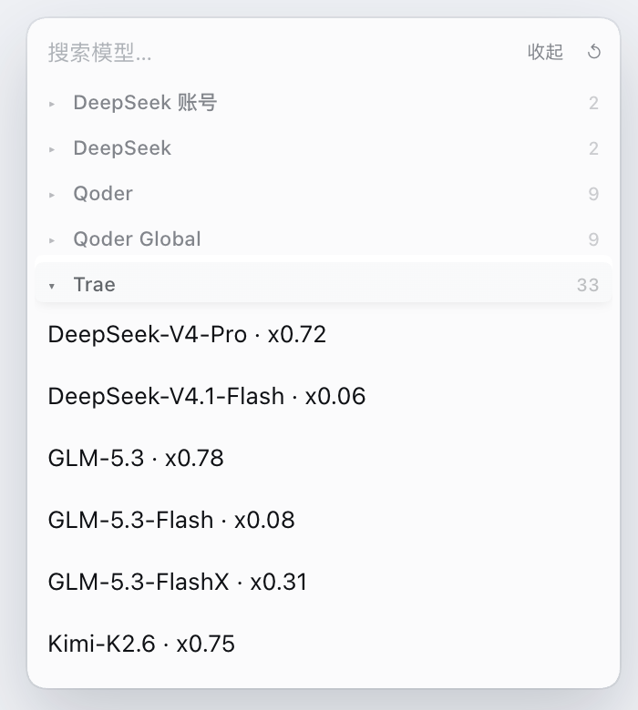
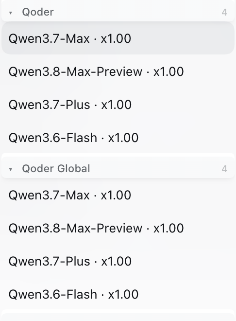
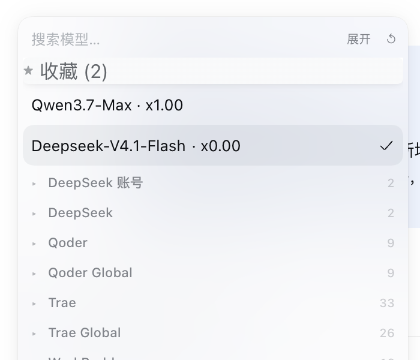
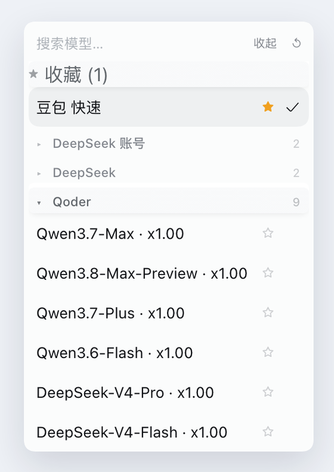
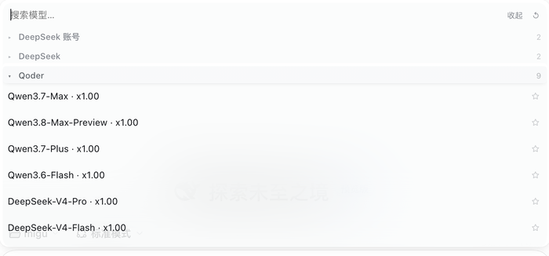

# dsh-model-accordion

[English](./README.md) · **简体中文**

> 把 DeepSeek Harness 的模型列表折叠成**每个供应商一行**。
> 点开 `Qoder`，只显示 Qoder 的模型，其他供应商全部收起。

<p align="center">
  
</p>

供应商十几个、模型几百个的时候，原生选择器就是一条无尽的滚动条。这个插件把每个供应商变成一行：
你只看到供应商名字和模型数量，想看具体模型再点开。

**两处模型列表都生效**：

- 输入框旁边的模型菜单；
- `/model` 斜杠命令弹窗。

---

## 效果

| 全部收起 | 展开一个 | 搜索 |
| --- | --- | --- |
|  |  |  |
| 九个供应商只占 8 行，点哪行开哪个。 | `Trae` 展开 33 个模型，其余保持收起。 | 输入 `qwen`，所有匹配的供应商自动展开。 |

<p align="center">
  
</p>

收藏的模型固定在供应商之上，常用的两三个模型永远一步可达。

<p align="center">
  
</p>

每个模型行右侧都有一颗星标：点一下即可收藏，不会顺带切换模型，所以一次打开菜单就能把几个常用模型都挑出来。`/model` 弹窗里行更宽，星标同样贴在右侧：

<p align="center">
  
</p>

---

## 功能

| 功能 | 用法 |
| --- | --- |
| **手风琴** | 点击供应商标题：它展开，其他供应商自动收起。 |
| **全部收起** | 再点一次已展开的供应商，或用工具栏按钮。 |
| **多开** | `Ctrl`/`Cmd` + 点击标题，切换该供应商而不关闭其他。 |
| **全部展开 / 收起** | 搜索行右侧的工具栏按钮。 |
| **记忆状态** | 展开的供应商在关闭菜单、刷新页面后仍然保留。 |
| **星标按钮** | 每行右侧都有星标，点击即收藏，不会切换当前模型。 |
| **收藏** | `Shift`+点击、右键点击或点星标，把模型固定到顶部 `★` 分组；点击收藏行即可选中。 |
| **一级菜单里的收藏** | 输入框菜单打开时的短面板（`模型` / `推理等级`）会把收藏排在两个单元格之上，常用模型从两步变一步。 |
| **收藏键稳定** | 收藏键在生成前会剥掉连接器插件追加的倍率后缀（` · x0.00`），所以促销开始或结束不会再让收藏「消失」，也不必切账号才回来。 |
| **重名模型不混淆** | 同一供应商下两个模型同名时（比如付费与免费的 `Deepseek-V4.1-Flash`），收藏会记住被收藏的具体模型，点收藏不会选到另一个。 |
| **供应商排序** | 工具栏 `↺` 循环切换：默认顺序 → 名称 A→Z → 模型数量 ↓N。 |
| **一键刷新模型** | 工具栏 `↻` 并行重新拉取各连接器的模型列表，并强制 composer 重读模型目录。 |
| **账号信息**（0.9.0） | 「模型连接器中心」显示当前账号名 / id / 域名 / 区域 / 凭据到期、完整账号列表（含各账号积分）、积分总额 / 套餐包、签到、OpenCode IP 池状态。 |
| **模型列表**（0.9.0） | 中心列出每个模型的上下文长度、积分倍率、推理 / 图像 / 新 / 下线标签，带区域切换、搜索框和刷新按钮。 |
| **账号配置**（0.9.0） | 直接在中心增删 Qoder PAT、切换 WorkBuddy 账号、OAuth 登录、刷新 Trae 账号、探测 OpenCode IP 池。 |
| **Qoder 本地登录**（0.9.1） | 一键拉取 Qoder 桌面客户端**当前**登录态（无需 PAT），记入账号池后即可在下拉里与 PAT 账号一起切换。详见 [Qoder 本地登录](#qoder-本地登录)。 |
| **Trae 多账号切换**（0.9.1） | 列出本机已保存的全部 Trae 登录并直接在中心切换，无需重新登录客户端。详见 [Trae 本地账号库](#trae-本地账号库)。 |
| **测试模型**（0.9.0） | 每个模型行有「测试」按钮，发起一次真实上游调用并就地显示结果 / 耗时。 |
| **标题显示当前模型** | 当前模型所在的供应商显示 `● <模型> · <数量>`。 |
| **固定高度** | 菜单高度保持稳定，不再在 260 px 和 368 px 之间跳动。 |
| **搜索穿透** | 在搜索框输入时所有供应商自动展开，匹配项不会被折叠藏住。 |
| **键盘操作** | `Tab` 到标题，`Enter`/`空格` 切换，`↑`/`↓` 在标题间移动，`→`/`←` 展开/收起。 |
| **中英双语** | 根据页面语言自动切换文案。 |
| **热重载** | 修改 `lib/client.js` 后一两秒内自动在页面里替换。 |

插件只**装饰 DOM**，不重写选择器。模型选择、推理等级切换、供应商加载和 `/model` 命令
仍然由 `@deepseek-ai/dsh-client-ui-model-selection` 负责，所以宿主更新选择逻辑时插件不会失效。

---

## 自包含连接器 + 统一设置界面（连接器中心）

**从 0.8.0 起，本插件是一次真正的物理合并。** WorkBuddy（5.17.0）、Trae（4.6.12）、
Qoder（`@dmh2002/dsh-connect-qoder` 1.16.4）、OpenCode（`@opencode2dsh/dsh-plugin`
0.3.14）四个连接器的**完整代码已复制进本包的 `vendored/` 目录**。停用原独立 bundle、改由本插件
提供这四个宿主入口后，**即使在 GUI 里把原来那四个连接器插件全部卸载，模型、登录态、已保存配置
和设置页都照常可用** —— 这正是「代码直接复制到当前插件，在卸载其他插件的情况下可以正常使用」。

实现要点：

- profile `cordis.patch.yml` 里新增四行 `- insert:`，`name` 用 `file:` URL 指向各自
  `vendored/<name>/lib/index.js`。四个 `entry.id` 沿用旧值（`dsh-connect-workbuddy`、
  `dsh-connect-trae`、`dsh-connect-qoder`、`opencode2dsh`），因为它们同时是 settings 命名空间、
  `/plugins/<id>/...` 路由前缀和已保存配置的键 —— 所以硬编码的路由、客户端 fetch、刷新目标、
  vault/auth 文件名、版本常量一个都不用改。四个宿主 `lib/index.js` 保持**互相独立的模块 URL**
  （它们顶层的 `Config` schema 和模块级 `Map`/`let` 单例不能合并，否则会串数据）。
- 每个 vendored 子包保留自己的 `dsh.client` + `exports["./client"]`；`nearestPackage` 把
  `file:` URL 解析到该子包 `package.json` 的 name，恰好等于其 `lib/client.js` 里
  `window.__ModuleLoader__.load({id})` 的 id —— 于是四份原生设置/登录 UI 继续生效，无需拼接客户端、
  无需改 slot key。两个独立 bundle（`dsh-connect-workbuddy`、`@opencode2dsh/dsh-plugin`）
  从 `dsh.profile.bundles` 移除，避免同一个包名在客户端 graph 里出现两个 source；它们的
  `dependencies` 仍在，所以 GUI 依旧把它们列为「已安装」并可卸载。
- workbuddy / trae 的 `config:` override 行去掉了 `name:`，尾部两条 `disabled: true` 也删了，
  这样账号 / 地区 / lastCatalog / enabledModelIds 等已保存配置按 id 落在新的 vendored 入口上。
- 四个宿主的裸 import（schemastery、pi-ai、dsh-llm、undici…）通过 `install.sh` 建的
  `node_modules/` shim 从 workspace 真实路径解析：schemastery 3.18.4 + cosmokit 来自 workbuddy
  自带的副本（opencode 的 `Config` 需要 `.volatile()`，全局树只有 3.18.2 没有它），其余依赖指向
  DSH 自带的 `~/.dsh/profiles/node_modules`（全局-backed，`pnpm remove` 不会删）。已验证：DSH 的
  `ResolutionRouter` 把这些 `file:` URL 交给原生 ESM，shim 正是解析裸 import 的地方。

统一设置界面（0.7.0 引入）是集中控制面板，在「设置 → 插件」页的**内置插件配置**里注册一张设置卡，
把四个连接器集中到一组标签页里。**从 0.9.0 起，四个原生设置页能做的事也搬进了中心**，不再需要打开原插件自己的配置页：

| 标签页 | 内容 |
| --- | --- |
| **总览** | 一次性探测全部连接器，用状态网格显示每个连接器的可达性、登录状态与模型数。 |
| **WorkBuddy / Trae / Qoder / OpenCode** | 状态卡 + **账号信息**（当前账号、账号列表含积分、积分总额 / 套餐包、签到、凭据到期）+ **模型列表**（每个模型的上下文 / 倍率 / 标签，区域切换、搜索、刷新）+ **账号配置**（Qoder PAT 增删、**本地登录拉取 / 记录 / 切换**、Qoder 账号下拉切换、WorkBuddy 账号切换与 OAuth 登录、Trae 账号刷新、OpenCode IP 池探测）；每个模型还有**测试**按钮。 |
| **手风琴选项** | 排序方式、固定高度、收藏（清空）、自动探测开关，以及「刷新全部模型」。 |

中心用纯浏览器 `fetch` 打四个 vendored 宿主已有的同源路由来重做这些配置流程。参考的
`daddy-suite` 代码贡献了「数据归一化 / 卡片字段 / 60 秒轮询（页面隐藏时跳过）」的范式；它的 CDP /
`window.ipc` / Electron 专用部分无法移植到 DSH 浏览器端插件，故刻意未照搬。「打开连接器设置」仍会尝试
跳到「已安装插件」里对应包的详情页；**卸载原独立插件后该列表行会消失**，此时按钮给出明确提示 —— 但中心本身
始终可用。四个宿主与中心都由本包提供，所以「插件」页里是否还列着原来的四个 npm 包已经无关紧要。

状态探测是只读的：三个 `/plugins/` 连接器用 `GET <prefix>/usage?region=<r>`（**0.9.0 去掉
`&detail=fast`**，保留完整账号 / 积分 / 模型字段）、`GET <prefix>/account-credits?region=<r>` 拿各账号积分；
OpenCode 用 `POST /api/opencode2dsh/ip-pool/status` 与 `/models`。`400`/`404`/`405` 或超时一律显示「未知」而不是报错，
所以某个端点暂时不可达也不会让整张卡失效。写路由都受 loopback 守卫保护：

| 连接器 | 账号配置 | 测试模型 |
| --- | --- | --- |
| WorkBuddy | `POST /__save {field:"accounts"}`（切换）、`/oauth?action=start\|poll`（登录）、`/accounts/refresh` | `POST /probe {modelIds:[id]}` |
| Trae | `POST /local-accounts?region=<区域> {action:sync\|switch, accountId}`（切换）、`/accounts/refresh`（加账号走桌面 App / `/transfer`） | `POST /models/test {ids:[id]}` —— **消耗真实额度** |
| Qoder | `POST /__save {field:"regions", value:{[区域]:{accountId}}}`（切换）、`POST /accounts?action=add\|remove {pat/accountId}`、`GET\|POST /local-login?region=<区域> {action:pull\|select\|remove}`（桌面登录态） | `GET /probe?model=<id>` |
| OpenCode | `/ip-pool/probe {scope:"all"}` | —（无单模型探测） |

### Qoder 本地登录

Qoder 桌面客户端把登录态存在 Electron `safeStorage` 密文里：
`~/Library/Application Support/com.qoder(cn).app.stable/auth.v1.dat`。中心的
Qoder 分页可以直接读取它，因此**无需创建 Personal Access Token** 就能使用
客户端当前已登录的账号：

1. 先在 Qoder 桌面客户端里登录到目标账号。
2. 打开中心 → **Qoder** → 「Qoder 本地登录」 → 「拉取当前本地登录」。
3. 账号会记入 `~/.dsh/.qoder-local-logins.<区域>.json`（权限 `0600`），并出现在
   「切换账号」下拉里，与 PAT 账号并列。
4. 选中它（或点该行的「切换账号」按钮）即写入
   `regions.<区域>.accountId` —— 连接器原生的账号选中字段。

要在已记录的账号之间切换，需要**先到 Qoder 客户端切换登录**，再回来点「拉取」：
客户端同一时刻只有一个活跃会话，因此选中一条「非当前登录」的记录会被
**明确报错并给出操作指引**，绝不会静默用另一个账号顶替。

实现上它不是 PAT：桌面 `dt-` 设备令牌过不了网关的 `jobToken` 交换（返回
`401 personal token is invalid`），但携带解密得到的真实 uid 后，可以直接作为
COSY 的 `security_oauth_token` 建会话（与 buddy-switch 的做法一致）。宿主因此
增加了一条设备凭据分支，用实时桌面登录态驱动对话 / 模型列表 / 用量查询。
凭据每次都从客户端加密文件重新读取——记录簿与 Web 接口只含身份元数据
（uid、昵称、到期时间），**不含任何令牌**。

### Trae 本地账号库

Trae 连接器宿主本身就支持多账号：自有凭据文件
`~/.dsh/.trae-auth.<区域>.json` 是 `{version:2, credentials:[...]}` 数组。默认
宿主只把桌面客户端**当前**登录镜像进去，所以中心只显示一个账号。但本机
TraeDaddy 的账号库里已经为**每个**用过的 Trae 账号保存了完整可用令牌：

```
~/Library/Application Support/TraeDaddy/profiles/
  trae-solo-cn/trae-native-<uid>.json     # 国内版账号
  trae-solo-intl/trae-native-<uid>.json   # 国际版账号
```

中心的 Trae 分页直接读取这个库：

1. 打开中心 → **Trae** → 「Trae 本地账号库」，会列出全部已保存登录，带昵称
   和「客户端当前登录」标签。
2. 点一次「同步本地账号」把它们合并进连接器凭据文件（切换时也会自动同步）。
3. 在「切换账号」下拉里选，或点该行的「切换」按钮。切换**立即生效**
   （已用一次真实上游模型调用验证），并且**重启后仍然保持**。

切换时会把账号库合并进自有凭据文件、调用 `store.selectAccount(id)` 让本次
会话立即生效，并通过与原生设置页相同的 settings 通道写入
`accounts.<panel>`；同时把选中账号排到凭据文件第一位作为独立兜底，因此
即使 settings 服务不可用，重启后选择也不会丢。Web 接口只返回身份元数据
（uid、昵称、到期时间、是否当前登录），**令牌绝不离开宿主进程**。

设置卡之所以出现在「内置插件配置」，是因为中心客户端注册了 `plugins.item` slot —— 插件管理器只根据 slot 条目构建该列表，
不依赖任何 settings 命名空间，因此它与「已安装插件」列表是否包含某个包无关。主插件自己的宿主半部 `lib/index.js`
仍是无依赖的 no-op（不导出 `Config`）；真正的模型 / 登录 / 配置能力来自 `vendored/<name>/lib/index.js` 这四个独立入口。
中心的偏好存在 `localStorage`，不写连接器的配置。

---

## 安装

桌面版 profile 由 Electron 应用独占，`dsh plugin add` 会拒绝写入。用脚本安装：

```sh
git clone https://github.com/lllbjs/dsh-model-accordion.git
cd dsh-model-accordion
./install.sh desktop        # 或：./install.sh "$DSH_PROFILE"
```

脚本会（幂等，可重复运行）：

1. 把本包软链到 `$DSH_HOME/profiles/<profile>/node_modules/dsh-model-accordion`；
2. 在包内建 `node_modules/` shim，让 vendored 宿主的裸 import 从 workspace 真实路径解析；
3. 在 `cordis.patch.yml` 头部写入 5 行 `- insert:`（本插件 + 4 个 `file:` 连接器入口），
   备份原文件，并清掉 0.7.0 遗留的 `name:` override 与 `disabled: true` 行；
4. 从 `package.json` 的 `dsh.profile.bundles` 移除两个独立 connector bundle（dependencies 保留，
   以便之后在 GUI 里卸载验证），备份原文件。

**装完必须完全退出并重新打开 DeepSeek Harness** —— profile 的 `package.json` / linked roots 在启动时
读取，仅刷新网页不够（`ResolutionRouter.replace` 会拒绝运行中替换）。重启后即可在 GUI 的「插件」页
把原来那四个连接器插件逐个卸载，模型、登录态与「模型连接器中心」都应照常可用。

手动安装等价于执行脚本，细节见 [`install.sh`](./install.sh)；不建议手写 `cordis.patch.yml`，因为 0.8.0
需要 4 行 `file:` URL 入口、shim、以及 bundles/config/disabled 的配套改动。

### 卸载

```sh
# 1. 从 cordis.patch.yml 删掉带 `# >>> dsh-model-accordion self-contained connectors` 注释的
#    - insert: 块（以及原来的 `- id: dsh-model-accordion` insert 行）
rm ~/.dsh/profiles/desktop/node_modules/dsh-model-accordion
# 2. 如需恢复独立插件：把两个 bundle 名字加回 dsh.profile.bundles，并从备份恢复 config override 行
```

卸载本插件后，四个连接器的宿主也随 `vendored/` 一起消失；若还想用原独立插件，先按上面的备份恢复。

---

## 操作

| 操作 | 手势 |
| --- | --- |
| 展开供应商 | 点击标题 |
| 收起已展开的供应商 | 再点一次标题 |
| 同时展开第二个 | `Ctrl`/`Cmd` + 点击 |
| 全部收起 | 工具栏按钮，或点掉唯一展开的那个 |
| 收藏模型 | 点击该行右侧星标，或 `Shift`+点击 / 右键点击该行 |
| 从一级菜单直接选收藏 | 点击即可：菜单先进入供应商列表，再选中该模型 |
| 选择模型 | 直接点击（收藏行同样有效） |
| 切换排序 | 工具栏 `↺` |
| 一键刷新各连接器模型 | 工具栏 `↻`（转圈 → `✓` / `!`） |

---

## 存储

所有状态存在界面同源的 `localStorage` 中：

| 键 | 值 |
| --- | --- |
| `dsh-model-accordion:open` | 已展开供应商标题的 JSON 数组 |
| `dsh-model-accordion:all-collapsed` | 主动全部收起时为 `true` |
| `dsh-model-accordion:favorites` | `供应商标题/模型名` 键的 JSON 数组（用的是界面可见文字，因此主菜单与 `/model` 弹窗互通） |
| `dsh-model-accordion:sort` | `default` \| `name` \| `size` |
| `dsh-model-accordion:missing-models` | 完整、无筛选的一次渲染里确认已不存在的收藏键 JSON 数组；只有它们会被挡在一级菜单外 |
| `dsh-model-accordion:favorite-ids` | 收藏键 → 被收藏那行的 `data-model-id` 的 JSON 对象，用于区分同一供应商下重名的两个模型 |
| `dsh-model-accordion:stable-height` | 设为 `false` 可让菜单按内容自适应高度 |
| `dsh-model-accordion:hub` | 统一设置界面偏好：`{ tab, autoProbe }`（当前标签页、是否自动探测） |
| `dsh-model-accordion:last-open` | 旧版键，仍会写入以兼容 |

---

## 诊断

插件挂载后，页面控制台可以访问 `window.__dshModelAccordion`：

```js
__dshModelAccordion.version      // "0.9.0"
__dshModelAccordion.rescan()     // 重新扫描 DOM
__dshModelAccordion.state()      // [{ open: [...], groups: [{ label, models, collapsed }] }]
__dshModelAccordion.favorites()  // ["qoder/qmodel_latest", ...]
__dshModelAccordion.sort()       // "default"
__dshModelAccordion.refresh()    // 执行一键刷新，返回 summary 的 Promise
__dshModelAccordion.refreshState()          // { status: "idle"|"busy"|"done"|"failed", at, detail }
__dshModelAccordion.refreshTargets()        // ["workbuddy/cn", "workbuddy/global", "trae/cn", "trae/ai", "qoder/cn", "qoder/global"]
__dshModelAccordion.registerRefreshTarget(t) // 注册连接器目标，返回注销函数
__dshModelAccordion.hub.connectors()        // 四个连接器的 id/pkg/version/providers/regions
__dshModelAccordion.hub.probe(conn)         // 探测单个连接器，返回状态对象
__dshModelAccordion.hub.openNative(pkg)     // 跳到该连接器的原生设置详情页
__dshModelAccordion.hub.state()             // 当前 hub 偏好（tab / autoProbe）
```

如果页面上出现了模型列表但没有识别出任何供应商分组，控制台会打印：

```
[dsh-model-accordion] a model list is present but no provider sections were found; the menu markup may have changed
```

说明宿主的菜单结构变了 —— 需要更新 [`lib/client.js`](./lib/client.js) 里的
`ROW_SELECTOR` 和 `[data-menu-group]` 相关假设。

---

## 一键刷新模型

工具栏 `↻` 按钮会并行重新拉取四个内置连接器（vendored 宿主）的模型列表，并强制 composer
重新读取缓存的模型目录。单纯关开菜单**不会**重新拉取：
`ModelCatalogDirectory.load()` 在 `status === "ready"` 时直接返回，所以按钮调用
`ctx.get("modelDirectories").catalog.refresh()`（invalidate + load）—— 这是浏览器侧
唯一能真正重新发起 `session/modelCatalog()` 的路径。

内置目标：

| 连接器 | 路由 | region |
| --- | --- | --- |
| WorkBuddy | `/plugins/dsh-connect-workbuddy/models/refresh` | `cn`、`global` |
| Trae | `/plugins/dsh-connect-trae/models/refresh` | `cn`、`ai` |
| Qoder | `/plugins/dsh-connect-qoder/models/refresh` | `cn`、`global` |

> Qoder（`@dmh2002/dsh-connect-qoder`）刻意使用**无 scope** 的 row id `dsh-connect-qoder`，
> 且刷新路由必须带 `?region=`，所以不能用带 `@dmh2002/` 前缀的路径。

均为同源 `POST`。端点暂时不可达时返回 `404`/`405`（空响应体），计为*跳过*而非失败。
反馈为执行中转圈、结束后 `✓` / `!`，以及类似 `4/4 · 95 models · catalog` 的提示，
3.5 秒后复位。

### 注册自己的连接器

其他插件无需 import 本 bundle，用 `document` 上的 `CustomEvent` 或直接调用即可：

```js
// 事件形式
document.dispatchEvent(new CustomEvent("dsh-model-accordion:refresh-register", {
  detail: { path: "/plugins/my-connector/models/refresh", label: "mine" }
}));

// 直接形式（返回注销函数）
const off = window.__dshModelAccordion.registerRefreshTarget(
  "/plugins/my-connector/models/refresh"
);
```

目标可以是 URL 字符串、对象
（`{ path, regions?, method?, headers?, label?, regionParam? }`）或异步函数。
每次刷新会广播两个事件：

- `dsh-model-accordion:refresh-start` —— detail 为 `{ targets: string[] }`；
- `dsh-model-accordion:refresh-done` —— detail 为刷新 summary
  （`{ started, ok, partial, succeeded, skipped, failed, total, models,
  catalogRefresh, results }`）。

### 限制

连接器的 `/models/refresh` 路由只把实时列表**返回**给设置草稿，不会写
`lastCatalog`，也不会发 `llm/adapters-updated`。Trae 的路由还会更新运行时的
`latestDiscovery` 池，因此它的新模型能立刻出现；WorkBuddy 的宿主侧目录只有在
该连接器提交设置保存后才会变化 —— 浏览器插件无法强制这次重新发布。因此按钮做的是
浏览器侧能做到的上限：预热各连接器的上游数据，并强制 composer 重读目录。

---

## 实现原理

```
lib/client.js                       浏览器 bundle —— 手风琴 + 统一设置界面，包在 window.__ModuleLoader__ 里
lib/index.js                        主插件宿主侧 —— 无依赖 no-op（name/inject/apply）；中心卡片来自 plugins.item slot
vendored/{workbuddy,trae,qoder,opencode}/lib/index.js   四个连接器宿主（独立模块 URL，保留原 entry id）
vendored/<name>/lib/client.js       四份原生设置/登录客户端（各自的 __ModuleLoader__.load id 与子包 name 一致）
install.sh                          链接本包 + 建 node_modules shim + 写 5 行 insert + 调整 bundles/config
```

1. 在 `document.body` 上挂 `MutationObserver`（`childList`、`subtree`），扫描模型列表：
   任何 `id$="-models"` 且子元素含 `[data-menu-group]` 的节点。
2. 每个供应商分组打上 `data-dsh-acc-collapsed`，收起分组里的行用 CSS 隐藏 ——
   不触发 React 重渲染，也不改虚拟 DOM。
3. 每个容器只绑定一次 click / keydown / input 处理，状态写回 `localStorage`。
4. `/model` 弹窗的结构不同（`div[role="option"]` 行，没有 `data-provider-id`），
   所以 `ROW_SELECTOR` 同时匹配两种形状；弹窗卡片被重排成两列网格，给工具栏腾位置。

---

## 兼容性

- DeepSeek Harness `0.2.1-rc.5` 及以上（在桌面版 bundle 上验证）。
- 无需构建：仓库里的 `lib/client.js` 就是浏览器 bundle；vendored 四包为已发布产物的原样复制。
- 运行时依赖由 `install.sh` 建的 shim 指向 DSH 自带的 `~/.dsh/profiles/node_modules` 与 workbuddy
  自带的 schemastery 3.18.4，不需要 `pnpm install` 本仓库。

---

## 许可证

MIT
