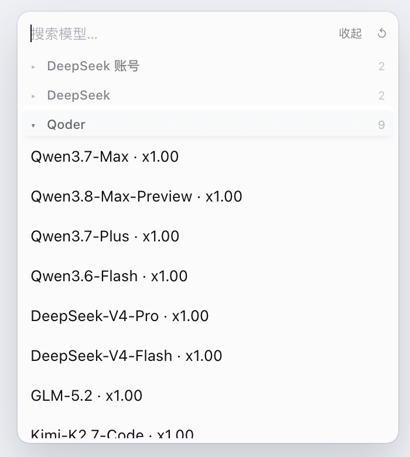
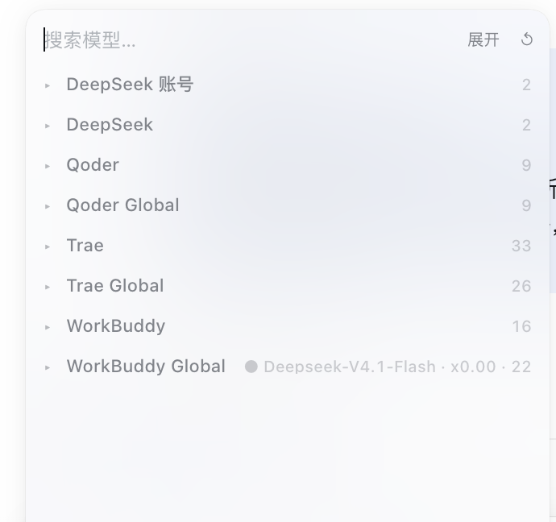
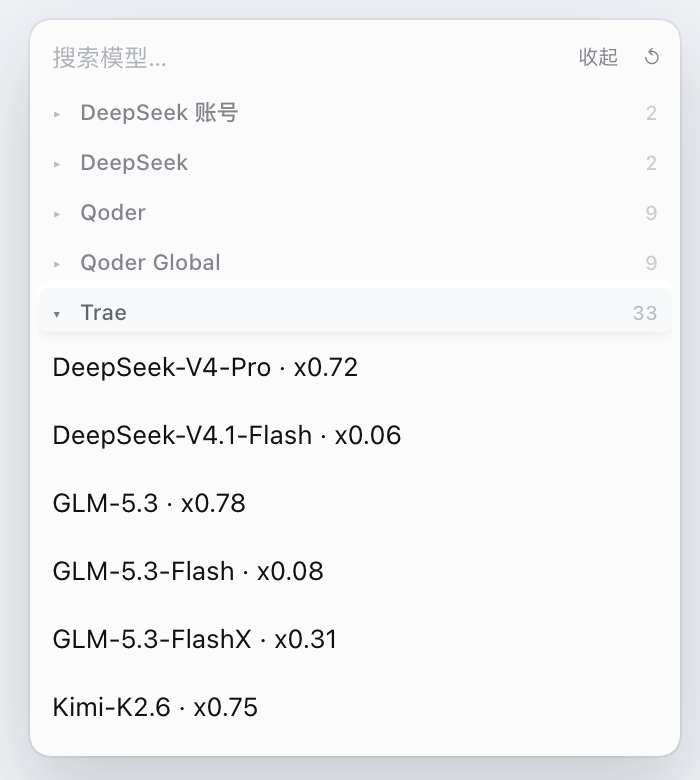
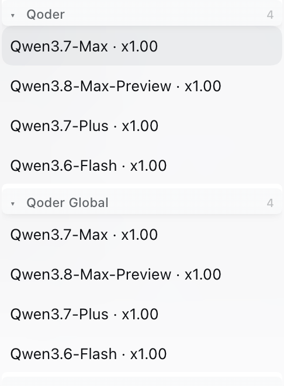
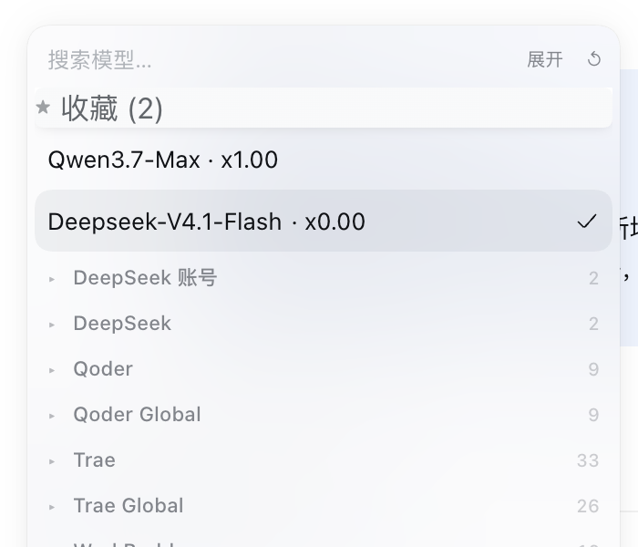
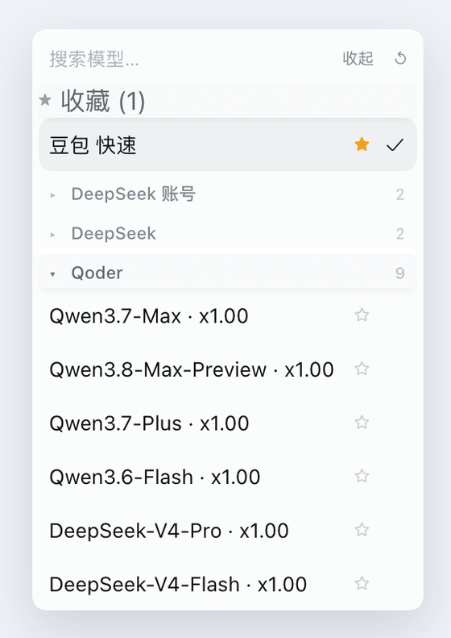
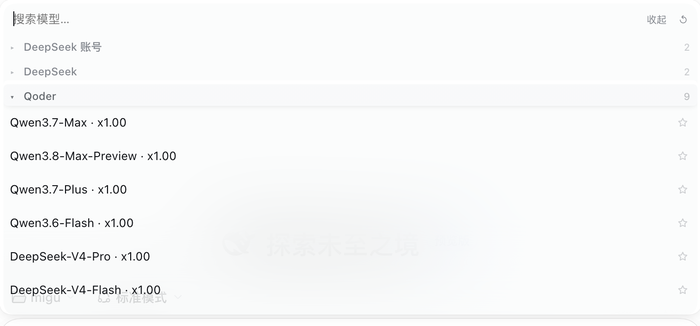

# dsh-model-accordion

[English](./README.md) · **简体中文**

> 把 DeepSeek Harness 的模型列表折叠成**每个供应商一行**。
> 点开 `Trae`，只显示 Trae 的模型，其他供应商全部收起。

<p align="center">
  
</p>

供应商十几个、模型几百个的时候，原生选择器就是一条无尽的滚动条。这个插件把每个供应商变成一行：
你只看到供应商名字和模型数量，想看具体模型再点开。

**两处模型列表都生效**：

- 输入框旁边的模型菜单；
- `/model` 斜杠命令弹窗。

---

## 效果

| 全部收起 | 展开一个 | 搜索 |
| --- | --- | --- |
|  |  |  |
| 九个供应商只占 8 行，点哪行开哪个。 | `Trae` 展开 33 个模型，其余保持收起。 | 输入 `qwen`，所有匹配的供应商自动展开。 |

<p align="center">
  
</p>

收藏的模型固定在供应商之上，常用的两三个模型永远一步可达。

<p align="center">
  
</p>

每个模型行右侧都有一颗星标：点一下即可收藏，不会顺带切换模型，所以一次打开菜单就能把几个常用模型都挑出来。`/model` 弹窗里行更宽，星标同样贴在右侧：

<p align="center">
  
</p>

---

## 功能

| 功能 | 用法 |
| --- | --- |
| **手风琴** | 点击供应商标题：它展开，其他供应商自动收起。 |
| **全部收起** | 再点一次已展开的供应商，或用工具栏按钮。 |
| **多开** | `Ctrl`/`Cmd` + 点击标题，切换该供应商而不关闭其他。 |
| **全部展开 / 收起** | 搜索行右侧的工具栏按钮。 |
| **记忆状态** | 展开的供应商在关闭菜单、刷新页面后仍然保留。 |
| **星标按钮** | 每行右侧都有星标，点击即收藏，不会切换当前模型。 |
| **收藏** | `Shift`+点击、右键点击或点星标，把模型固定到顶部 `★` 分组；点击收藏行即可选中。 |
| **一级菜单里的收藏** | 输入框菜单打开时的短面板（`模型` / `推理等级`）会把收藏排在两个单元格之上，常用模型从两步变一步。 |
| **收藏键稳定** | 收藏键在生成前会剥掉连接器插件追加的倍率后缀（` · x0.00`），所以促销开始或结束不会再让收藏「消失」，也不必切账号才回来。 |
| **重名模型不混淆** | 同一供应商下两个模型同名时（比如付费与免费的 `Deepseek-V4.1-Flash`），收藏会记住被收藏的具体模型，点收藏不会选到另一个。 |
| **供应商排序** | 工具栏 `↺` 循环切换：默认顺序 → 名称 A→Z → 模型数量 ↓N。 |
| **一键刷新模型** | 工具栏 `↻` 并行重新拉取内置连接器的模型列表，并强制 composer 重读模型目录。 |
| **标题显示当前模型** | 当前模型所在的供应商显示 `● <模型> · <数量>`。 |
| **固定高度** | 菜单高度保持稳定，不再在 260 px 和 368 px 之间跳动。 |
| **搜索穿透** | 在搜索框输入时所有供应商自动展开，匹配项不会被折叠藏住。 |
| **键盘操作** | `Tab` 到标题，`Enter`/`空格` 切换，`↑`/`↓` 在标题间移动，`→`/`←` 展开/收起。 |
| **中英双语** | 根据页面语言自动切换文案。 |
| **热重载** | 修改 `lib/client.js` 后一两秒内自动在页面里替换。 |

插件只**装饰 DOM**，不重写选择器。模型选择、推理等级切换、供应商加载和 `/model` 命令
仍然由 `@deepseek-ai/dsh-client-ui-model-selection` 负责，所以宿主更新选择逻辑时插件不会失效。

---

## 自包含连接器

**从 0.8.0 起，本插件是一次真正的物理合并。** 三个连接器宿主的完整代码 ——
WorkBuddy（5.31.2）、Trae（4.18.7）以及 OpenCode（`@opencode2dsh/dsh-plugin` 0.3.14
连同 `dsh-opencode-go` 0.4.0）—— 已复制进本包的 `vendored/` 目录。停用原独立 bundle、改由本插件
提供这些宿主入口后，**即使在 GUI 里把原来的连接器插件全部卸载，模型、登录态、已保存配置
和各自的设置页都照常可用** —— 这正是「代码直接复制到当前插件，在卸载其他插件的情况下可以正常使用」。
每个连接器都自包含：账号、积分、模型管理与诊断都在**它自己的设置页**里完成。本插件只提供模型菜单手风琴，不附加任何集中式设置面板。

实现要点：

- profile `cordis.patch.yml` 里新增 `- insert:` 行，`name` 用 `file:` URL 指向各自
  `vendored/<name>/lib/index.js`。`entry.id` 沿用旧值（`dsh-connect-workbuddy`、
  `dsh-connect-trae`、`opencode2dsh`，以及 `opencode-go`），因为它们同时是 settings 命名空间、
  `/plugins/<id>/...` 路由前缀和已保存配置的键 —— 所以硬编码的路由、客户端 fetch、刷新目标、
  vault/auth 文件名、版本常量一个都不用改。各宿主 `lib/index.js` 保持**互相独立的模块 URL**
  （它们顶层的 `Config` schema 和模块级 `Map`/`let` 单例不能合并，否则会串数据）。
- 每个 vendored 子包保留自己的 `dsh.client` + `exports["./client"]`；`nearestPackage` 把
  `file:` URL 解析到该子包 `package.json` 的 name，恰好等于其 `lib/client.js` 里
  `window.__ModuleLoader__.load({id})` 的 id —— 于是原生设置 / 登录 UI 继续生效，无需拼接客户端、
  无需改 slot key。独立 bundle（`dsh-connect-workbuddy`、`dsh-connect-trae`、
  `@opencode2dsh/dsh-plugin`、`dsh-opencode-go`）从 `dsh.profile.bundles` 移除，避免同一个包名
  在客户端 graph 里出现两个 source；它们的 `dependencies` 仍在，所以 GUI 依旧把它们列为「已安装」并可卸载。
- workbuddy / trae 的 `config:` override 行去掉了 `name:`，尾部两条 `disabled: true` 也删了，
  这样账号 / 地区 / lastCatalog / enabledModelIds 等已保存配置按 id 落在新的 vendored 入口上。
- 宿主的裸 import（schemastery、pi-ai、dsh-llm、undici…）通过 `install.sh` 建的
  `node_modules/` shim 从 workspace 真实路径解析：schemastery 3.19.0 + cosmokit 来自 workbuddy
  自带的副本（opencode 的 `Config` 需要 `.volatile()`，全局树只有 3.18.2 没有它），其余依赖指向
  DSH 自带的 `~/.dsh/profiles/node_modules`（全局-backed，`pnpm remove` 不会删）。已验证：DSH 的
  `ResolutionRouter` 把这些 `file:` URL 交给原生 ESM，shim 正是解析裸 import 的地方。

主插件自己的宿主半部 `lib/index.js` 仍是无依赖的 no-op；真正的模型 / 登录 / 配置能力来自
三个独立的 `vendored/<name>/lib/index.js` 入口及其各自的设置页。手风琴自身需要的一切
（展开分组、收藏、排序、固定高度）都存放在 `localStorage`。

---

## 安装

桌面版 profile 由 Electron 应用独占，`dsh plugin add` 会拒绝写入。用脚本安装：

```sh
git clone https://github.com/lllbjs/dsh-model-accordion.git
cd dsh-model-accordion
./install.sh desktop        # 或：./install.sh "$DSH_PROFILE"
```

脚本会（幂等，可重复运行）：

1. 把本包软链到 `$DSH_HOME/profiles/<profile>/node_modules/dsh-model-accordion`；
2. 在包内建 `node_modules/` shim，让 vendored 宿主的裸 import 从 workspace 真实路径解析；
3. 在 `cordis.patch.yml` 头部写入 `- insert:` 行（本插件 + 3 个 `file:` 连接器入口，
   外加独立的 `opencode-go` 行），备份原文件，并清掉 0.7.0 遗留的 `name:` override 与
   `disabled: true` 行；
4. 从 `dsh.profile.bundles` 移除独立 connector bundle（dependencies 保留，
   以便之后在 GUI 里卸载验证），备份原文件。

**装完必须完全退出并重新打开 DeepSeek Harness** —— profile 的 `package.json` / linked roots 在启动时
读取，仅刷新网页不够（`ResolutionRouter.replace` 会拒绝运行中替换）。重启后即可在 GUI 的「插件」页
把原来的连接器插件逐个卸载，模型与登录态照常可用，各连接器自己的设置页也依旧存在。

手动安装等价于执行脚本，细节见 [`install.sh`](./install.sh)；不建议手写 `cordis.patch.yml`，因为
`file:` URL 入口、shim、以及 bundles/config/disabled 的配套改动需要一起完成。

### 卸载

```sh
# 1. 从 cordis.patch.yml 删掉带 `# >>> dsh-model-accordion self-contained connectors`
#    注释的 - insert: 块（以及原来的 `- id: dsh-model-accordion` insert 行），
#    还有独立的 `# >>> vendored opencode-go host` 块
rm ~/.dsh/profiles/desktop/node_modules/dsh-model-accordion
# 2. 如需恢复独立插件：把 bundle 名字加回 dsh.profile.bundles，并从备份恢复 config override 行
```

卸载本插件后，连接器宿主也随 `vendored/` 一起消失；若还想用原独立插件，先按上面的备份恢复。

---

## 操作

| 操作 | 手势 |
| --- | --- |
| 展开供应商 | 点击标题 |
| 收起已展开的供应商 | 再点一次标题 |
| 同时展开第二个 | `Ctrl`/`Cmd` + 点击 |
| 全部收起 | 工具栏按钮，或点掉唯一展开的那个 |
| 收藏模型 | 点击该行右侧星标，或 `Shift`+点击 / 右键点击该行 |
| 从一级菜单直接选收藏 | 点击即可：菜单先进入供应商列表，再选中该模型 |
| 选择模型 | 直接点击（收藏行同样有效） |
| 切换排序 | 工具栏 `↺` |
| 一键刷新各连接器模型 | 工具栏 `↻`（转圈 → `✓` / `!`） |

---

## 存储

所有状态存在界面同源的 `localStorage` 中：

| 键 | 值 |
| --- | --- |
| `dsh-model-accordion:open` | 已展开供应商标题的 JSON 数组 |
| `dsh-model-accordion:all-collapsed` | 主动全部收起时为 `true` |
| `dsh-model-accordion:favorites` | `供应商标题/模型名` 键的 JSON 数组（用的是界面可见文字，因此主菜单与 `/model` 弹窗互通） |
| `dsh-model-accordion:sort` | `default` \| `name` \| `size` |
| `dsh-model-accordion:missing-models` | 完整、无筛选的一次渲染里确认已不存在的收藏键 JSON 数组；只有它们会被挡在一级菜单外 |
| `dsh-model-accordion:favorite-ids` | 收藏键 → 被收藏那行的 `data-model-id` 的 JSON 对象，用于区分同一供应商下重名的两个模型 |
| `dsh-model-accordion:stable-height` | 设为 `false` 可让菜单按内容自适应高度 |
| `dsh-model-accordion:last-open` | 旧版键，仍会写入以兼容 |

---

## 诊断

插件挂载后，页面控制台可以访问 `window.__dshModelAccordion`：

```js
__dshModelAccordion.version      // "0.10.0"
__dshModelAccordion.rescan()     // 重新扫描 DOM
__dshModelAccordion.state()      // [{ open: [...], groups: [{ label, models, collapsed }] }]
__dshModelAccordion.favorites()  // ["trae/deepseek-v3", ...]
__dshModelAccordion.sort()       // "default"
__dshModelAccordion.refresh()    // 执行一键刷新，返回 summary 的 Promise
__dshModelAccordion.refreshState()          // { status: "idle"|"busy"|"done"|"failed", at, detail }
__dshModelAccordion.refreshTargets()        // ["workbuddy/cn", "workbuddy/global", "trae/cn", "trae/ai"]
__dshModelAccordion.registerRefreshTarget(t) // 注册连接器目标，返回注销函数
```

如果页面上出现了模型列表但没有识别出任何供应商分组，控制台会打印：

```
[dsh-model-accordion] a model list is present but no provider sections were found; the menu markup may have changed
```

说明宿主的菜单结构变了 —— 需要更新 [`lib/client.js`](./lib/client.js) 里的
`ROW_SELECTOR` 和 `[data-menu-group]` 相关假设。

---

## 一键刷新模型

工具栏 `↻` 按钮会并行重新拉取内置连接器（WorkBuddy 和 Trae）的模型列表，并强制 composer
重新读取缓存的模型目录。单纯关开菜单**不会**重新拉取：
`ModelCatalogDirectory.load()` 在 `status === "ready"` 时直接返回，所以按钮调用
`ctx.get("modelDirectories").catalog.refresh()`（invalidate + load）—— 这是浏览器侧
唯一能真正重新发起 `session/modelCatalog()` 的路径。

内置目标：

| 连接器 | 路由 | region |
| --- | --- | --- |
| WorkBuddy | `/plugins/dsh-connect-workbuddy/models/refresh` | `cn`、`global` |
| Trae | `/plugins/dsh-connect-trae/models/refresh` | `cn`、`ai` |

OpenCode 的模型由它自己的宿主 / 设置页管理，不在这个浏览器侧并行刷新范围内。
均为同源 `POST`。端点暂时不可达时返回 `404`/`405`（空响应体），计为*跳过*而非失败。
反馈为执行中转圈、结束后 `✓` / `!`，以及类似 `4/4 · 95 models · catalog` 的提示，
3.5 秒后复位。

### 注册自己的连接器

其他插件无需 import 本 bundle，用 `document` 上的 `CustomEvent` 或直接调用即可：

```js
// 事件形式
document.dispatchEvent(new CustomEvent("dsh-model-accordion:refresh-register", {
  detail: { path: "/plugins/my-connector/models/refresh", label: "mine" }
}));

// 直接形式（返回注销函数）
const off = window.__dshModelAccordion.registerRefreshTarget(
  "/plugins/my-connector/models/refresh"
);
```

目标可以是 URL 字符串、对象
（`{ path, regions?, method?, headers?, label?, regionParam? }`）或异步函数。
每次刷新会广播两个事件：

- `dsh-model-accordion:refresh-start` —— detail 为 `{ targets: string[] }`；
- `dsh-model-accordion:refresh-done` —— detail 为刷新 summary
  （`{ started, ok, partial, succeeded, skipped, failed, total, models,
  catalogRefresh, results }`）。

### 限制

连接器的 `/models/refresh` 路由只把实时列表**返回**给设置草稿，不会发
`llm/adapters-updated`。

- **Trae** 会持久化发现的目录：通过宿主的 settings 服务写入
  `regions.<panel>.lastCatalog`（与原生设置页同一条写入路径）并重装运行时目录，
  因此全量模型在页面刷新**以及完整重启应用后**都保留。
- **WorkBuddy** 的宿主侧目录只有在该连接器提交设置保存后才会变化 —— 浏览器插件
  无法强制这次重新发布。对这类连接器，按钮做的是浏览器侧能做到的上限：预热
  上游数据，并强制 composer 重读目录。

---

## 实现原理

```
lib/client.js                       浏览器 bundle —— 手风琴，包在 window.__ModuleLoader__ 里
lib/index.js                        主插件宿主侧 —— 无依赖 no-op（name/inject/apply）
vendored/{workbuddy,trae,opencode}/lib/index.js   连接器宿主（独立模块 URL，保留原 entry id）
vendored/opencode-go/lib/index.js   OpenCode Go 宿主（独立模块 URL，opencode-go entry id）
vendored/<name>/lib/client.js       原生设置/登录客户端（各自的 __ModuleLoader__.load id 与子包 name 一致）
install.sh                          链接本包 + 建 node_modules shim + 写 insert 行 + 调整 bundles/config
```

1. 在 `document.body` 上挂 `MutationObserver`（`childList`、`subtree`），扫描模型列表：
    任何 `id$="-models"` 且子元素含 `[data-menu-group]` 的节点。
2. 每个供应商分组打上 `data-dsh-acc-collapsed`，收起分组里的行用 CSS 隐藏 ——
    不触发 React 重渲染，也不改虚拟 DOM。
3. 每个容器只绑定一次 click / keydown / input 处理，状态写回 `localStorage`。
4. `/model` 弹窗的结构不同（`div[role="option"]` 行，没有 `data-provider-id`），
    所以 `ROW_SELECTOR` 同时匹配两种形状；弹窗卡片被重排成两列网格，给工具栏腾位置。

---

## 兼容性

- DeepSeek Harness `0.2.1-rc.5` 及以上（在桌面版 bundle 上验证）。
- 无需构建：仓库里的 `lib/client.js` 就是浏览器 bundle；vendored 各包为已发布产物的原样复制。
- 运行时依赖由 `install.sh` 建的 shim 指向 DSH 自带的 `~/.dsh/profiles/node_modules` 与 workbuddy
  自带的 schemastery 3.19.0，不需要 `pnpm install` 本仓库。

---

## 许可证

MIT
